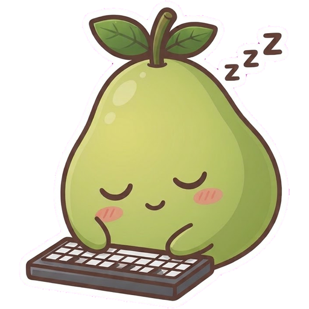
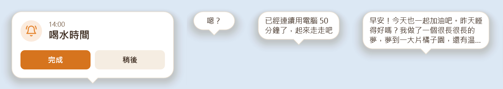
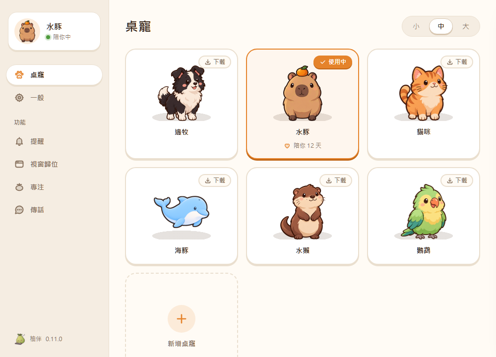

# 柚伴 Youban Desktop Pet

**住在你 Windows 桌面上的小水豚** 
在工作列上散步、打瞌睡、爬螢幕邊，到了午餐時間提醒你吃飯，用電腦太久叫你起來走走。 
「柚伴」念起來就是「有伴」。

**[⬇ 下載最新版](../../releases/latest)**

## ✨ 牠會做什麼

- 🐾 **陪你**　散步、坐下、打哈欠、爬上螢幕邊、站到視窗頂上；你拖動視窗，坐在上面的牠會跟著走
- 🎾 **跟你玩**　摸摸頭會開心、點一下會轉圈圈、甩出去會撞牆反彈（甩太多次會暈）；看到滑鼠在地上會撲過去
- 💬 **講話**　早安、午餐、下班、深夜各有不同的話；被戳太多次會抗議；講話頻率可以調，也可以叫牠安靜
- 🍡 **餵點心、丟球**　右鍵選單丟一個下去，牠會跑過去吃、追著踢
- 💛 **陪伴天數**　記得你們一起過了幾天，紀念日會跳起來慶祝
- ⏰ **提醒**　每天、每週、每月、工作日、上班時間每小時……遇到國定假日可以跳過、順延或提前
- 🪟 **視窗歸位**　外接螢幕拔掉再接回來，視窗自動放回原位
- 🐹 **多隻桌寵**　用一張圖就能新增自己的桌寵，缺的動作再慢慢補

   
  

  

## 📦 安裝

1. 到 [Releases](../../releases/latest) 下載 `youban-desktop-pet-<版本>.zip`
2. 解開到任何資料夾
3. 執行 `petcore.exe`，水豚就會出現在工作列上方
4. 對牠按右鍵打開設定；要開機自動啟動，在設定 →「一般」打開

有新版時會先問你，再找空檔自動換上。

## 🎮 怎麼跟牠玩

| 想做什麼 | 怎麼做 |
|---|---|
| 摸摸頭 | 滑鼠在牠身上左右來回晃幾下 |
| 打招呼 | 點牠一下 |
| 換個地方 | 按住拖走；用力一甩會飛出去 |
| 餵點心、丟球 | 對牠按右鍵 →「餵點心」「丟球」；點一下球會彈起來 |
| 看陪伴天數 | 對牠按右鍵，第一行就是 |
| 換一隻桌寵、改設定 | 對牠按右鍵 →「換一隻桌寵」「設定…」 |
| 叫牠安靜 | 設定 →「桌寵」→ 講話選「不講」 |

## 🍃 輕、不吃資源

- 閒置時記憶體約 6～12MB，一直開著也不會越用越大
- 全螢幕看影片、簡報、玩遊戲時自動躲起來，提醒等你回來再跳出來

## ❓ 常見問題

**第一次打開，Windows 跳出「Windows 已保護您的電腦」？**
點「其他資訊」→「仍要執行」。這是因為程式沒有花錢買數位簽章，不是病毒。

**怎麼確定下載的檔案沒被改過？**
每個版本的說明裡都有 SHA-256 驗證碼。在下載資料夾開 PowerShell 執行 `Get-FileHash youban-desktop-pet-<版本>.zip`，算出來的值一樣就沒問題。

**怎麼關掉？** 對牠按右鍵 →「結束」。

**怎麼移除？** 先到設定 →「一般」把「開機自動啟動」關掉，再刪掉解壓縮的那個資料夾。
想連設定和陪伴天數一起清掉，再刪 `%APPDATA%\youban-desktop-pet` 和 `%LOCALAPPDATA%\youban-desktop-pet`。